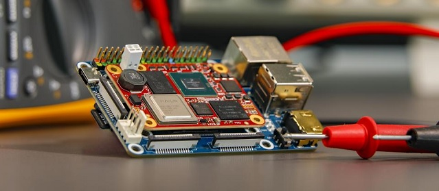
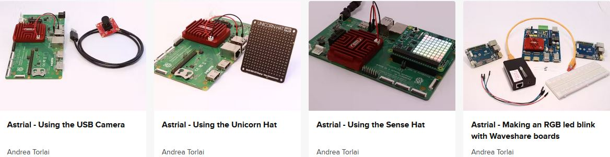
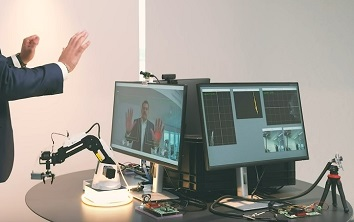

  

----

# Embedded Linux for ASTRIAL SoM 
Quickly get your ASTRIAL started with the full-featured and energy-efficient i.MX family and Hailo-8 neural network processor. Our goal is to provide you with a comprehensive Linux environment that is easy to develop your designs with thus reducing your time to market.

# Astrial channels
Follow us on the main website [www.astrial.ai](http://www.astrial.ai) and on social media for the latest news on ai@edge :

  

## Documentation
Astrial combines an NXP i.MX8M Plus processor with a Hailo-8 AI accelerator.
Its documentation includes System Electronics board documentation, NXP BSP documentation and Hailo software documentation.

Hardware schematics and the operating guide are available on the
[Astrial documentation page](https://www.systemelectronics.ai/en/documents).

Prebuilt images, release notes and the corresponding NXP documentation are
available in the
[Astrial download area](https://coesia.sharepoint.com/:f:/s/systemelectronics_ai_ftp/EoEh2naiznZFreJtwZs2nucBY0I14Uj7lH1TAlr6h7WKFg?e=7ybMh5).

Navigate to `ASTRIAL IMX8MP H8 → linux_BSP → yocto`, then select
`scarthgap` or `kirkstone` and the required release.
Always use the documentation and instructions corresponding to your BSP release.

For all Astrial BSP releases, obtain Hailo documentation and the Hailo AI
Software Suite directly from the [Hailo Developer Zone](https://hailo.ai/developer-zone/), which requires a
registered account.

To compile neural network models into `.hef` files for execution on Astrial,
use the Hailo Dataflow Compiler and follow the compatibility requirements
for the HailoRT version included in your image. Refer to the release notes
for the software versions used by each Astrial release.

For video and multimedia development on Scarthgap, refer to chapter 7.3,
"Multimedia use cases", of the i.MX Linux User's Guide (UG10163), included
in the NXP documentation package for Astrial v2.0.0.

## Tutorials
On Hackster.io you will find step-by-step tutorials for simple task on Astrial. Each tutorial has a video explanation too. See the Hackster.io main page here: [https://www.hackster.io/andrea-torlai](https://www.hackster.io/andrea-torlai)

  

## Communities
Being a platform based on both NXP i.mx8m-plus and Hailo H8, Astrial users can leverage both communities for questions outside of the documentation and available examples.
For NXP imx8 you can refer to [NXP imx8 community](https://community.nxp.com//?profile.language=en). For Hailo you can refert to [Hailo-8 community](https://community.hailo.ai/tag/hailo8)

## Software Releases
The following sections provide the BSP repositories, build instructions and prebuilt image download locations for the Astrial Yocto release families.

Astrial v2.0.0 is based on Scarthgap. Previous v1.1.x releases are based on Kirkstone. 
Select the section matching the image you are using.

---

### Yocto/Scarthgap — Astrial v2.0.0

Based on NXP Linux BSP `imx-6.6.52-2.2.0`.

Astrial v2.0.0 is the first Scarthgap release and includes the fixes from
the Kirkstone v1.1.x series up to and including v1.1.5.
It integrates HailoRT 4.23.0 and TAPPAS-Core 5.3.0.

Prebuilt Images

Download the standard Astrial images from
[SysEle SharePoint](https://coesia.sharepoint.com/:f:/s/systemelectronics_ai_ftp/EoEh2naiznZFreJtwZs2nucBY0I14Uj7lH1TAlr6h7WKFg?e=7ybMh5).

Folder:
`ASTRIAL IMX8MP H8 → linux_BSP → yocto → scarthgap → v2.0.0`

The release folder contains:

- System images for the 2 GB, 4 GB and 8 GB RAM variants.
- Matching `imx-boot` binaries for eMMC programming.
- MD5 checksum files.
- NXP documentation and release notes.

Select the image matching your board's RAM configuration.
For eMMC programming, also select the matching `imx-boot` binary.
For MicroSD programming, the bootloader is already included in the image.

Read `RELEASE NOTES.txt` and verify the supplied checksums before programming.

Follow the Scarthgap
[Board Programming guide](https://github.com/System-Electronics/meta-sysele-astrial-imx8/blob/scarthgap/ASTRIAL-YOCTO-INSTALL.md#board-programming)
for installation instructions.

_Pre-built images are provided for evaluation and testing purposes,
not for final production use._

Yocto Build Guidelines

To build or customize the Scarthgap image, use the
[Astrial Scarthgap BSP repository](https://github.com/System-Electronics/meta-sysele-astrial-imx8/tree/scarthgap)
and follow its
[Yocto build instructions](https://github.com/System-Electronics/meta-sysele-astrial-imx8/blob/scarthgap/ASTRIAL-YOCTO-INSTALL.md).

The guide covers the available 2 GB, 4 GB and 8 GB RAM configurations.

Display Configuration

For instructions on enabling the DSI display interface, see
[Enable DSI](https://github.com/System-Electronics/meta-sysele-astrial-imx8/blob/scarthgap/ASTRIAL-ENABLE-DSI.md).

Security Guidelines

- [Build a secure boot image](https://github.com/System-Electronics/meta-sysele-astrial-imx8/blob/scarthgap/ASTRIAL-YOCTO-INSTALL.md#build-secure-boot-image).
- [Encrypted storage](https://github.com/System-Electronics/meta-sysele-astrial-imx8/blob/scarthgap/ASTRIAL-ENCRYPTED-STORAGE.md).
- [SE050 cryptochip](https://github.com/System-Electronics/meta-sysele-astrial-imx8/blob/scarthgap/ASTRIAL-SE05x.md).

---

### Yocto/Kirkstone — Astrial v1.1.x

Prebuilt Images 

Use our prebuilt images for a quick jumpstart of your system, you can download the files from the SystemElectronics sharepoint.

Click [SysEle-Sharepoint](https://coesia.sharepoint.com/:f:/s/systemelectronics_ai_ftp/EoEh2naiznZFreJtwZs2nucBY0I14Uj7lH1TAlr6h7WKFg?e=7ybMh5) to 
access the sharepoint and download the release you are looking for.

Folder:
`ASTRIAL IMX8MP H8 → linux_BSP → yocto → kirkstone`

Select the required release folder and read its release notes before programming.
  
To properly bringup your board and install the prebuiltimage see the detail howto on Hackster.io bringup:
  
[Bringup Guidelines](https://www.hackster.io/andrea-torlai/astrial-bringup-guidelines-6f8423)  

For eMMC programming, follow the
[Board Programming guide](https://github.com/System-Electronics/meta-sysele-astrial-imx8/blob/kirkstone/ASTRIAL-YOCTO-INSTALL.md#board-programming), including the steps required to enter USB-OTG programming mode.

_Pre-built images are provided for evaluation and testing purposes, not for final production use._

Yocto Build Guidelines

If you want to build an customize your yocto/linux build see the details on page: 

[astrial meta layer](https://github.com/System-Electronics/meta-sysele-astrial-imx8/tree/kirkstone).

Official Demo

The Astrial official demo for Embedded World 2024 is a gesture control for a robotic arm.
here is the video on youtube:

[https://www.youtube.com/watch?v=RwSaMLdL3Fw](https://www.youtube.com/watch?v=RwSaMLdL3Fw)

If you want to learn how to replicate our official demo see instructions here: [astrial dobot demo](https://github.com/System-Electronics/astrial_dobot_demo_ew2024).

Astrial Tutorials

If you want to learn how to run our tutorials, please see instructions at the link: 

[astrial tutorials](https://github.com/System-Electronics/astrial-tutorials)

Security Guidelines

If you want to learn how to build a secure boot image, please see the following section of the main guide:

[secure boot](https://github.com/System-Electronics/meta-sysele-astrial-imx8/blob/kirkstone/ASTRIAL-YOCTO-INSTALL.md#build-secure-boot-image).

If you want to learn how to encrypt storage on Astrial, please see the example at the link:

[encrypted storage](https://github.com/System-Electronics/meta-sysele-astrial-imx8/blob/kirkstone/ASTRIAL-ENCRYPTED-STORAGE.md).

If you want to learn how to use the cryptochip SE050, please see the guide at the link:

[edgelock se050](https://github.com/System-Electronics/meta-sysele-astrial-imx8/blob/kirkstone/ASTRIAL-SE05x.md).

